# The Collection

Design boards for the Fish Journal's Collection ([#400](https://github.com/timemir/pagle-addon/issues/400)): every look in Pagle and every Ledger title on one spread, with a Curio Shop that only sells. The spec is `docs/spec/ledger.md` (LED-R166–R175), with `docs/spec/core/wallet-and-shop.md` (SHOP-R24, SHOP-R36, SHOP-R40), `docs/spec/core/README.md` (CORE-R45) and `docs/spec/settings.md` (SET-R50).

The boards are captures of the design canvas, which is clickable: open a shelf, filter, pick a look, use it. The looks are the kits' own art (toast styles, bindings, crests, tracker frames); the Angler's state on them (Level 34, what is owned and in use, every count) is invented for the design, and so are the dates. Six tracker frames and three bindings that no kit drew a picture of in a form the canvas could use are drawn as stand-ins: Ink Wash, Wax Seal, Corkboard, Tideworn Plank, Logbook, Ship's Brass, Tooled Leather, Verdigris and Lacquered Red.

| Board | What it shows |
|---|---|
| 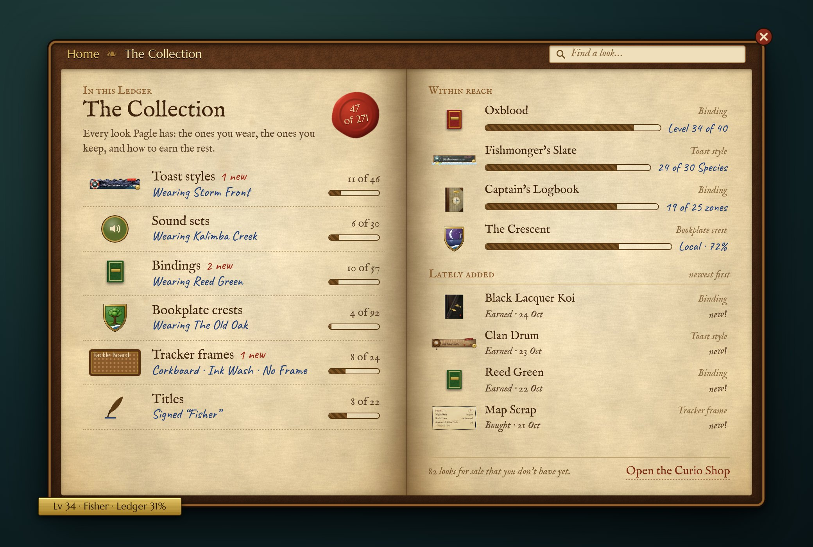 | The Collection's own spread: a shelf per slot, Titles last, each with the look in use, "{n} new" and an ink bar; on the right, the four looks within reach and the four added lately (LED-R168) |
| 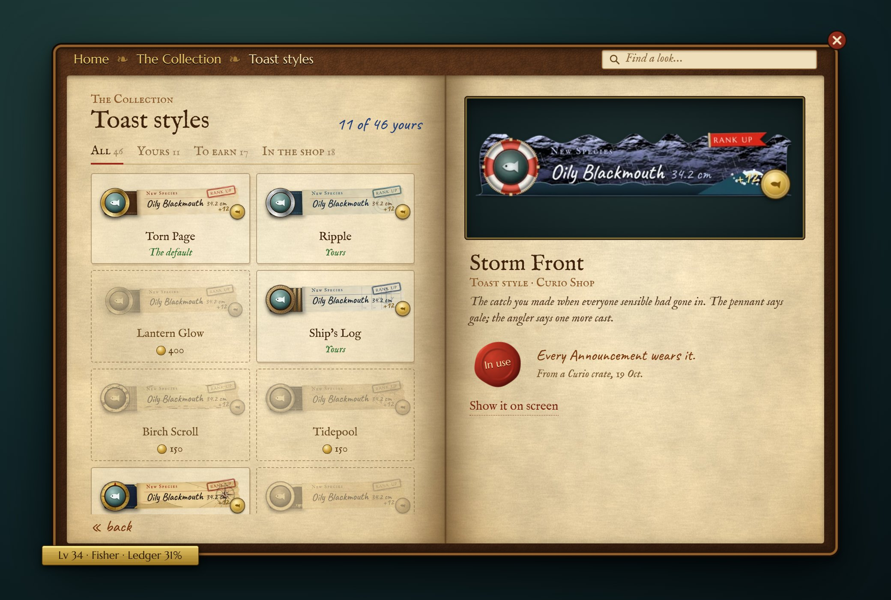 | A shelf: owned looks in their colours, the rest in pencil and still named (LED-R169, LED-R170); the right page on the look in use |
| 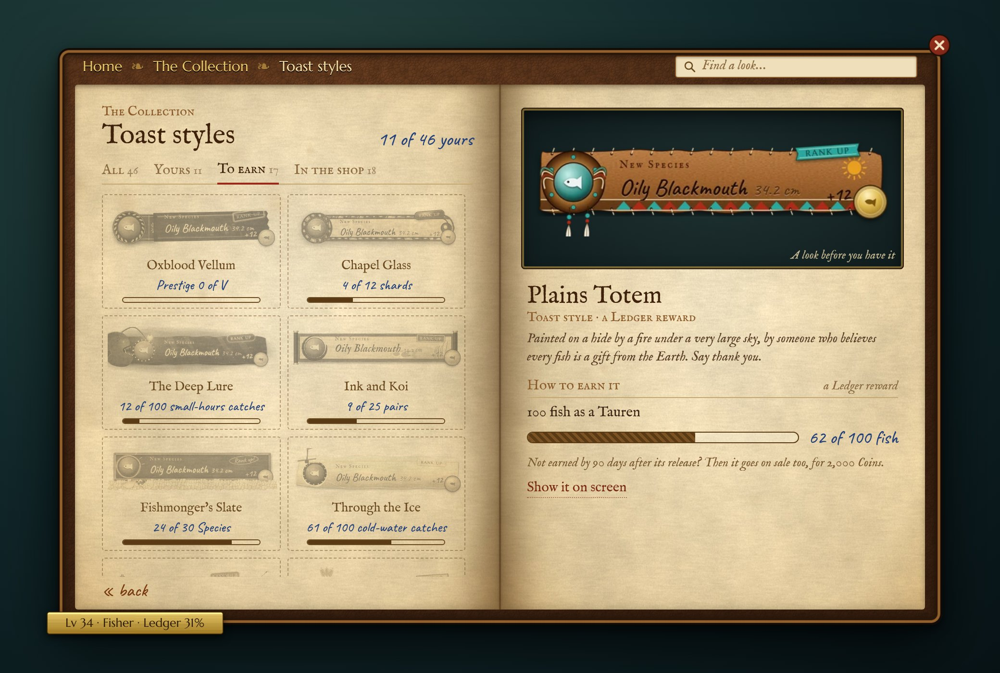 | "To earn": the right page with how to earn it, its count and its later price (LED-R170) |
| 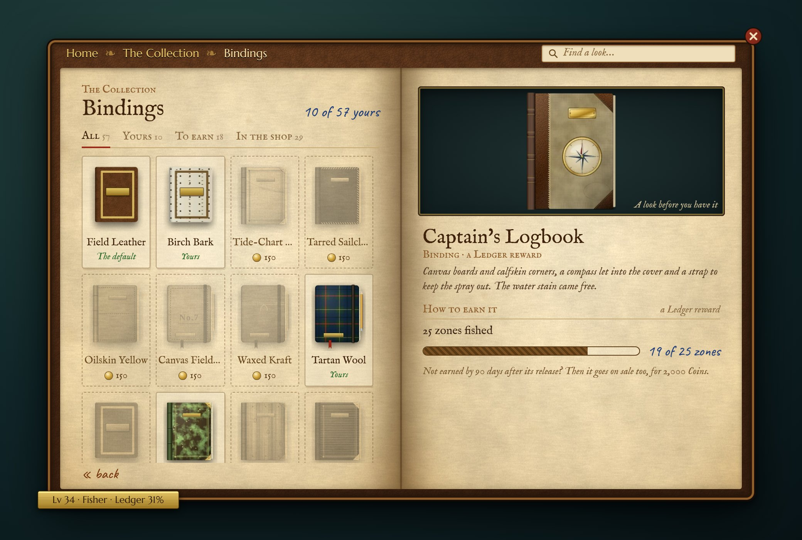 | Bindings as closed books, four across |
| 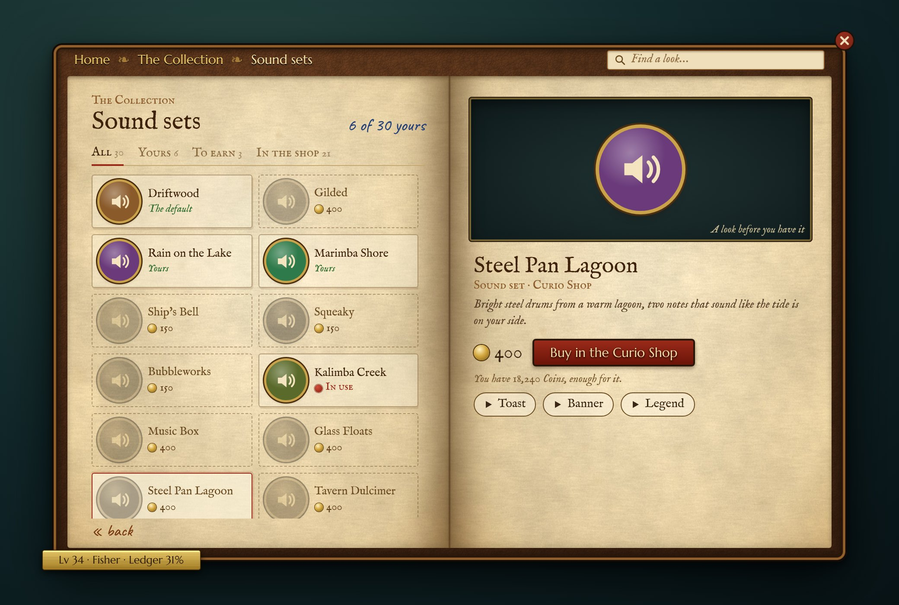 | Sound sets: a brass speaker each, ▶ Toast / Banner / Legend; one for sale, with its price and "Buy in the Curio Shop" |
| 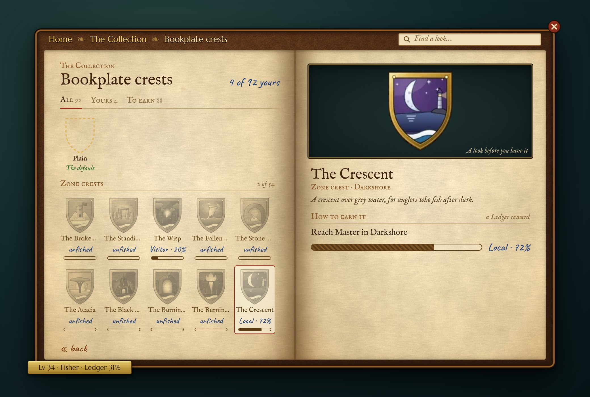 | Crests five across under their groups; a zone crest's rank toward Master |
| 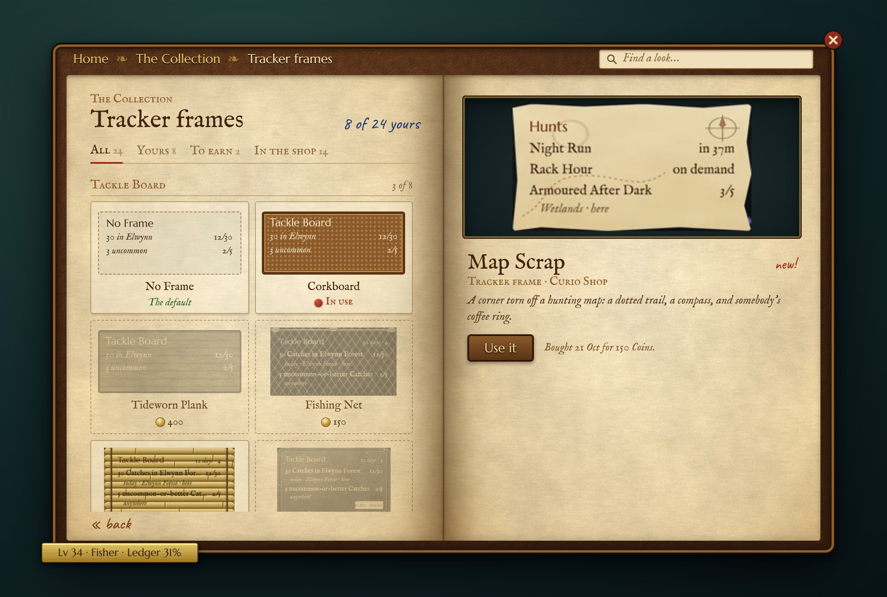 | Tracker frames grouped by Module, each group with its own look in use; a new one |
| 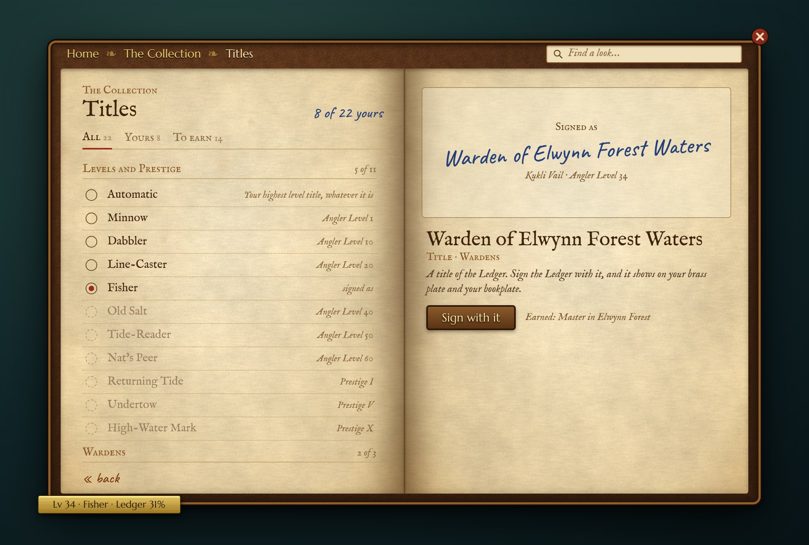 | The Ledger's titles as a pick list; the right page signs with the chosen one |
| 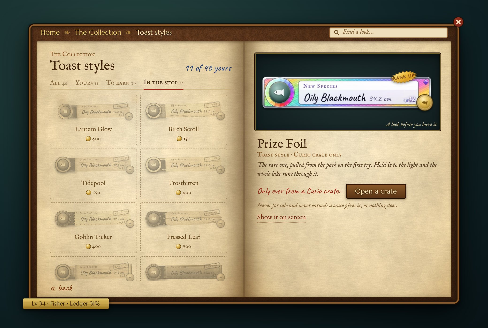 | "In the shop", on a crate-only look |
| 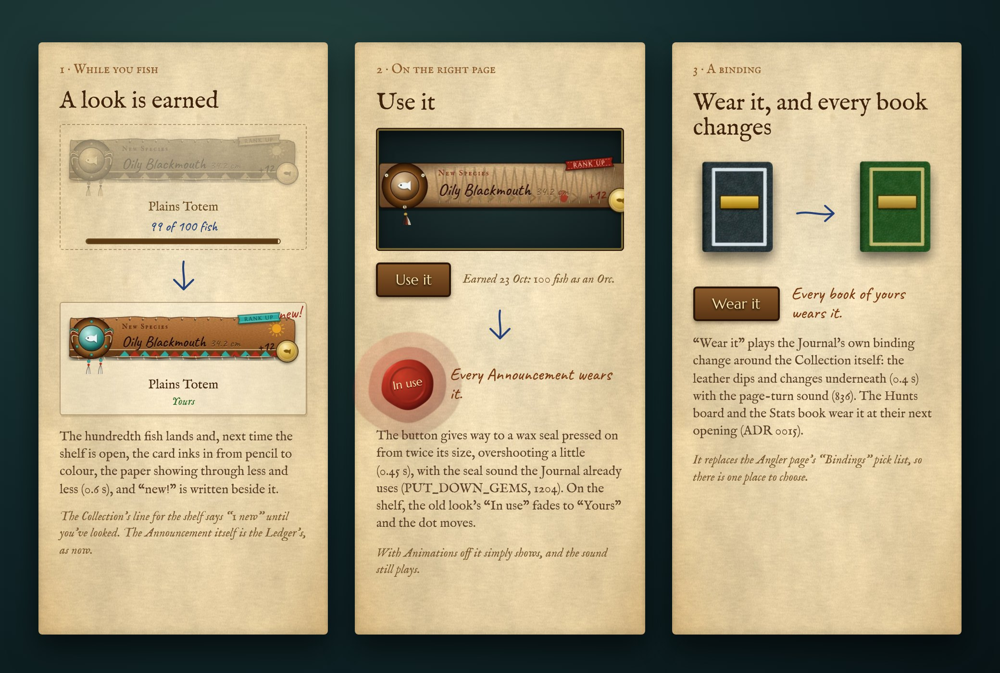 | Moments: a look earned inks in from pencil; "Use it" presses the wax on; "Wear it" changes every book |
| 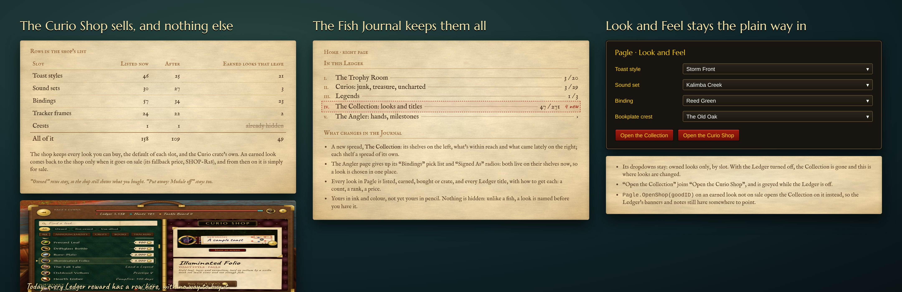 | What moves where: the Curio Shop's list, 158 rows down to 109; the Journal's contents line; Look and Feel's "Open the Collection" |
